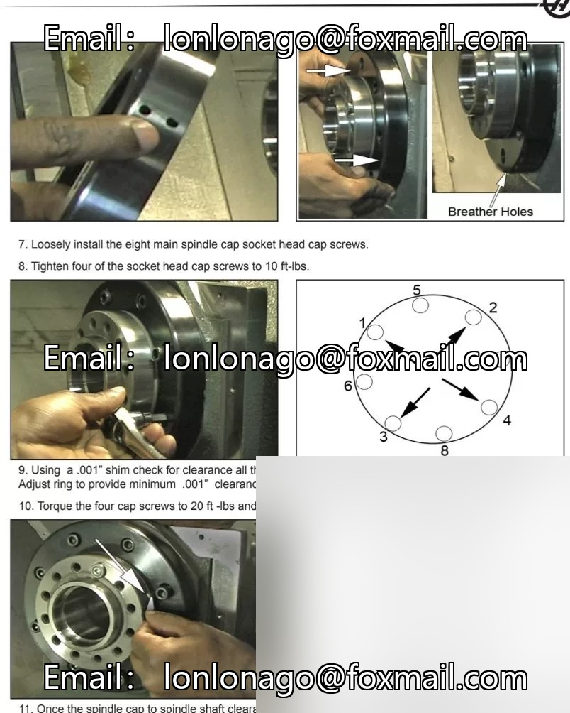
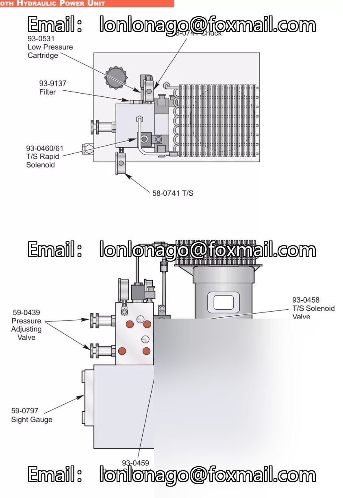
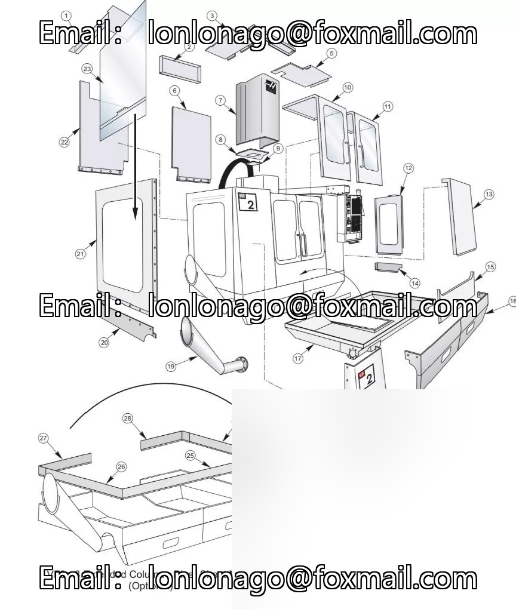
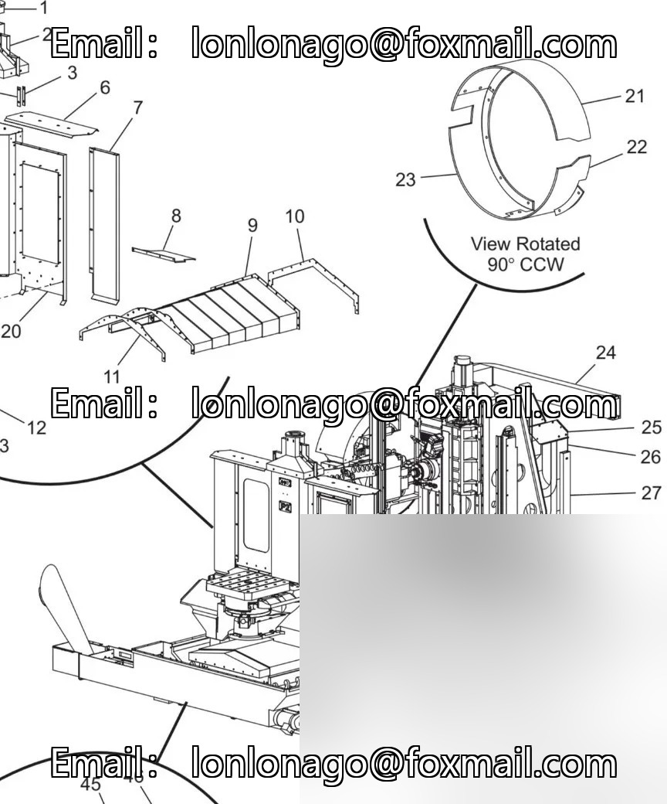

# Haas Automation Inc. (Haas Automation Company)

## Body

Haas Automation Inc. (Haas Automation Company)published the "Milling Machine and Lathe Service Manual: Mechanical Components" 700-page PDF .
The materials are in PDF format, complete in content, suitable for maintenance, maintenance, and study of Haas CNC machines and related mechanical components.
The are copyable, and cannot be returned after sale.
270458221-HA..

The material is a 700-page PDF from Haas Automation Inc. (HASSAutomation Inc.), titled “Grinding and Lathe Service Manual: Mechanical Parts”; it is complete and suitable for maintenance, repair and learning about Haas CNC lathe-related mechanical parts, with copyability and an unsellable policy.

<!-- AI_ENRICHED -->

## Images

## Payment

Here is a pay link on Stripe ( https://buy.stripe.com/3cs8yP7sY87d0vu9AB ). Please contact me lonlonago@foxmail.com after funding $89, and I will send you a complete data files , thank you!

